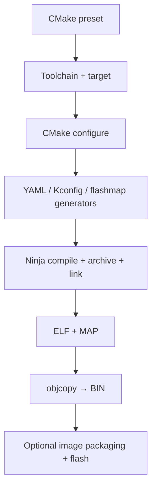
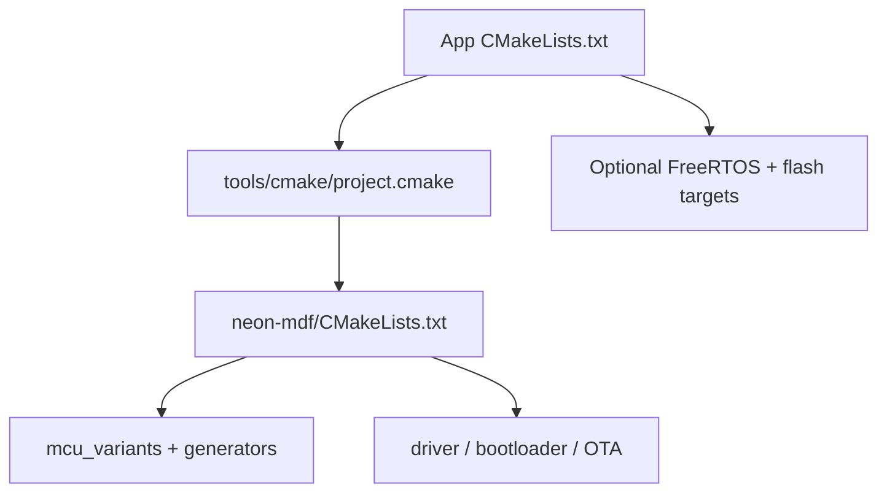
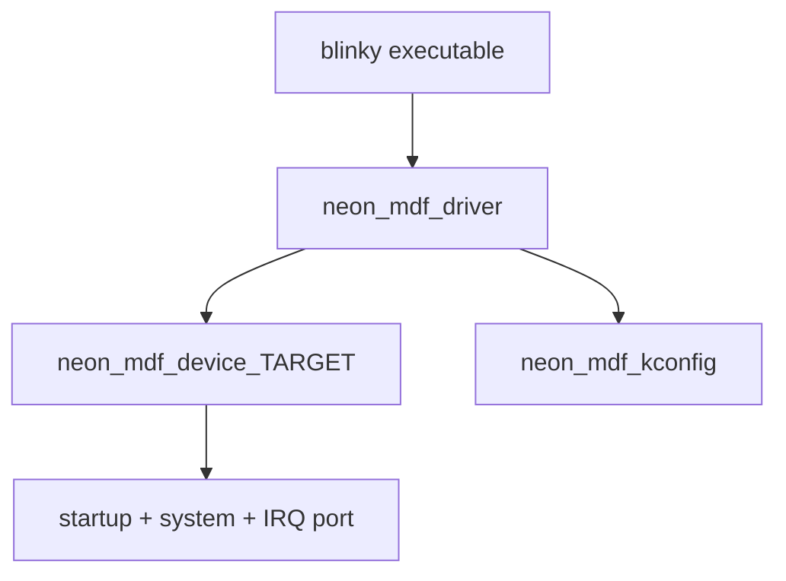
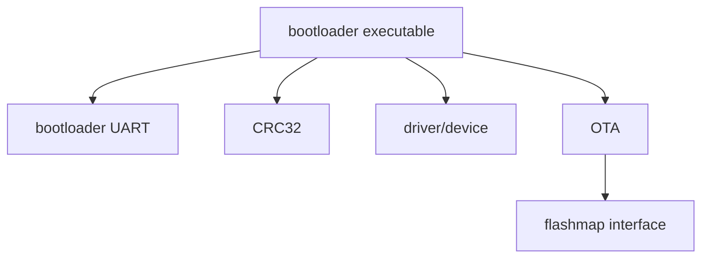

# Analyze the whole CMake and build system of NEON_MDF

## 0. Scope and how to read this document

This document statically analyzes all CMake files in the extracted SDK, along with the files directly involved in configure, generate, compile, link, create image, flash and integrate VS Code.

- Do not modify SDK source code.
- Do not run the flash command.
- Do not treat addresses or parameters in the YAML/generated file as independently verified silicon data. The document only describes how the build system uses those values.
- The paths in the document are relative paths calculated from `survey/neon-mdf_gpt/`.
- The three files under `examples/Blinky/build/WEACT_F412/CMakeFiles/4.4.2/` are CMake - generated output, not source build script.
- The files below `neon-mdf/rtos/FreeRTOS-Kernel/` are third-party/upstream. NEON_MDF using only a part of them.

## 1. Overall picture

In this SDK, CMake doesn't directly “compile everything” as soon as reading `CMakeLists.txt`. The process divides into five phases:

1. Select preset and toolchain: `CMakePresets.json` select target, Ninja, build directory and toolchain file.
2. **Configure**: CMake reads `CMakeLists.txt`/`.cmake`, runs Python generator, creates target graph and writes `CMakeCache.txt`/`build.ninja`.
3. **Generate build data**: YAML generates device/startup/linker/SVD; Kconfig generates `sdkconfig.h`/`sdkconfig.cmake`; flashmap generates header/CMake fragment/linker scripts.
4. Build: Ninja calls compiler, assembler, archiver and linker to create `.o`, `.a`, `.elf`, `.map`.
5. **Post-build/flash**: `objcopy` creates `.bin`; custom targets package image header/OTA and call OpenOCD or UART flasher.



The minimum command from the folder an application, for example `examples/Blinky/`:

```bash
cmake --preset WEACT_F412
cmake --build --preset WEACT_F412
```

The first command is configure/generate.. The second command is compile/link.. CLI `neon_mdf.py` and extension VS Code only wrap these two commands.

## 2. CMake concepts to understand first

### 2.1 Target

Target is a named build unit. The SDK creates three main types:

- `STATIC`: create library `.a`, for example `neon_mdf_driver`.
- `INTERFACE`: does not create binary; only passes include path, macro or dependency, for example `neon_mdf_kconfig`.
- `EXECUTABLE`: create firmware `.elf`, for example `blinky`, `bootloader`.

Custom targets such as `menuconfig`, `flash_jtag` do not generate ELF; they run commands declared with `add_custom_target()`.

### 2.2 `PRIVATE`, `PUBLIC`, `INTERFACE`

- `PRIVATE`: use current target only dependency/flag.
- `PUBLIC`: the current target used and the target linked to it.
- `INTERFACE`: the target itself does not compile; consumer inherits.

For example, `neon_mdf_driver PUBLIC neon_mdf_device_<TARGET>` makes the driver and app link driver both inherit include path device header and CPU flags.

### 2.3 Cache and environment

- Cache variables live in `build/<TARGET>/CMakeCache.txt`, e.g. `NEON_MDF_TARGET`.
- Environment variables live in process shell, e.g. `NEON_MDF_PATH`, `NEON_MDF_SERIAL_PORT`.
- `set(... CACHE STRING ...)` keeps the value through configures.
- Changing toolchain/target in an old build directory is easy to cause dirty cache; the preset design avoids that by giving each target a separate folder.

### 2.4 Scope and `PARENT_SCOPE`

Each `function()` has its own scope; each `add_subdirectory()` also creates directory scope. So variables like linker script must be pushed through multiple layers:

```text
neon_mdf_configure_target() function
  → neon-mdf/CMakeLists.txt directory scope
    → application CMakeLists.txt directory scope
```

This is why the code has multiple consecutive `set(... PARENT_SCOPE)`.

### 2.5 Generator expression

The `$<TARGET_FILE:name>` syntax is only evaluated at generate/build time, not when CMake is reading the file. It tells CMake exactly the target artifact path on each platform.

## 3. Entry point: Where does CMake start?

Each application is a standalone CMake project. The real entry point is the app's `CMakeLists.txt`, not `neon-mdf/CMakeLists.txt`.

For example `examples/Blinky/CMakeLists.txt` does:

1. `cmake_minimum_required(VERSION 3.21)`.
2. `project(blinky C ASM)` enable C and Assembly languages.
3. Ensure the `NEON_MDF_PATH` environment exists.
4. `include(.../tools/cmake/project.cmake)` to load the whole SDK.
5. Based on `NEON_MDF_BOOTLOADER_ENABLED`, create a whole-flash firmware or multiple firmware bootloader/factory/OTA.

Main include/subdirectory relations:



## 4. Analyze each CMake file owned by NEON_MDF

### 4.1 `neon-mdf/tools/cmake/project.cmake`

This is the only public entry point that the app needs to include.

Main contents:

- Line 25–32: resolve `NEON_MDF_PATH` according to CMake variable preferences → environment → inferred from file location.
- Line 38–45: resolve `NEON_MDF_TARGET`, defaults to `FU2`, and write to cache.
- 47–50 series: test target is in `NEON_MDF_KNOWN_TARGETS`.
- Line 52: `add_subdirectory(${NEON_MDF_PATH} neon-mdf-build)` pulls the SDK into the app's project.
- `neon_mdf_add_executable()`: create whole-flash firmware.
- `neon_mdf_add_app_executable()`: create app after bootloader with `_APP.ld`.
- `neon_mdf_add_bootloader_executable()`: create bootloader using source provided by SDK and `_BOOTLOADER.ld`.

The three executable helpers all perform the same sequence:

```text
add_executable
→ link library
→ mounts linker script with -T → requires relink when linker script changes
→ post-build objcopy -O binary
→ in size report
```

The direct output is `<name>.elf`, `<name>.elf.map` and `<name>.elf.bin`. Since `$<TARGET_FILE:name>` already carries the suffix `.elf`, the `.map`/`.bin` append command produces names of the form `.elf.map` and `.elf.bin`, not pure `<name>.map`/`<name>.bin`.

No Intel HEX creation target; no `objcopy -O ihex`.

### 4.2 `neon-mdf/CMakeLists.txt`

This is the root of the SDK but not a standalone top-level project.

Actual Flow:

1. Check the `NEON_MDF_TARGET`.
2. Include `mcu_variants.cmake` and call `neon_mdf_configure_target()`.
3. Push device target, linker script, arch and bootloader metadata to app scope.
4. Select `flashmap.<TARGET>.csv`; if not, fallback `flashmap.csv`.
5. If target has bootloader and app has flashmap, call `neon_mdf_process_flashmap()`.
6. For supported family, run Kconfig, add drivers, and then add bootloader if necessary.

Important point about order: flashmap is processed before `components/bootloader` so that target `neon_mdf_ota` can exist before bootloader executable link it.

### 4.3 `neon-mdf/cmake/mcu_variants.cmake`

This is the registry target and factory that creates the device library.

Existing Registry:

| Target | Arch variable | Family | Additional Properties |
|---|---|---|---|
| `FU2` | `cortex-m0` | `FU2` | no bootloader fragment |
| `WEACT_F412` | `cortex-m4` | `WEACT_F412` | `FPU=ON` |
| `CH32V003F4P6` | `riscv-rv32ec` | `CH32V003` | vendor `WCH`, ABI `ilp32e` |

`neon_mdf_configure_target()` does four big things:

1. Find `python3` and run `mcu-description/tools/generate.py --device <target>` right in the configure phase.
2. Dispatch according to `arch` to Cortex-M or RISC-V.
3. Create `neon_mdf_device_<TARGET>` including `system_*.c`, startup assembly, IRQ port and, with RISC-V, `riscv_soft_math.c`.
4. If generated bootloader fragment exists, include it and export linker script path whole-flash/bootloader/app with metadata memory/erase.

The device library is where the CPU flags, including path and target macros are distributed to the entire dependency graph.

### 4.4 `neon-mdf/cmake/arch/cortex-m.cmake`

Define `neon_mdf_apply_cortex_m_arch(target, mcpu, [fpu])`.

- Always add `-mcpu=<core>` and `-mthumb` for compile and link.
- No FPU: `-mfloat-abi=soft`.
- With FPU: `-mfloat-abi=hard -mfpu=fpv4-sp-d16`.

Set the flag at `PUBLIC` so that consumer targets inherit the ABI. This is essential: object builds with hard-float and soft-float are not arbitrarily linked.

### 4.5 `neon-mdf/cmake/arch/riscv.cmake`

Define `neon_mdf_apply_riscv_arch(target, isa, abi)`.

- Compile and link with `-march=${isa}_zicsr`.
- Compile and link with `-mabi=${abi}`.
- Self add extension `zicsr` because startup use CSR command.

For the current CH32, the values passed from the registry are the ISA `rv32ec` and the ABI `ilp32e`.

### 4.6 `neon-mdf/cmake/toolchain/arm-none-eabi.cmake`

Role: tell CMake this is cross-compilation bare-metal ARM.

- `CMAKE_SYSTEM_NAME Generic`: no host OS target.
- `CMAKE_SYSTEM_PROCESSOR arm`.
- `CMAKE_TRY_COMPILE_TARGET_TYPE STATIC_LIBRARY`: CMake checks compiler using library, avoiding trying to run/link executable on host.
- Default prefix `arm-none-eabi-`.
- Choose `gcc`, `g++`, `objcopy`, `objdump`, `size`.
- Suffix executable `.elf`.
- C/C++ uses function/data sections to linker garbage-collect section unused.
- C++ disables RTTI and exceptions.
- Linker using newlib-nano, nosys stubs, `--gc-sections`, `--print-memory-usage`.

Note: the app currently implements `project(... C ASM)`, not enable `CXX`. The toolchain setting `CMAKE_CXX_COMPILER` does not automatically make `.cpp` buildable; C++ applications must implement `CXX` in `project()`.

### 4.7 `neon-mdf/cmake/toolchain/riscv-none-elf.cmake`

The role is similar to the ARM version but for the bare-metal RISC-V toolchain.

- Default prefix is `riscv64-elf-`, although output can be RV32 thanks to multilib/flags.
- Use `-ffreestanding` in compile.
- No newlib specs; linker uses `-nostdlib -ffreestanding`.
- Suffix `.elf`.

Comment line 52–63 says `libgcc` will be linked from device target, but current code in `mcu_variants.cmake` does not link `gcc`; instead it compiles `riscv_soft_math.c`. This is an outdated comment compared to current implementation.

### 4.8 `neon-mdf/cmake/kconfig.cmake`

Define `neon_mdf_process_kconfig(APP_DIR, [KCONFIG_FILE])`.

Configure-time flow:

1. Set environment `NEON_MDF_APP_KCONFIG=<app>/Kconfig`.
2. Find `python3`.
3. Check the import is `kconfiglib`.
4. Run `tools/kconfig/gen_config_header.py`.
5. create `build/<target>/config/sdkconfig.h` and `sdkconfig.cmake`.
6. Include `sdkconfig.cmake` so that CMake has the variable `CONFIG_*`.
7. Create `neon_mdf_kconfig` INTERFACE library containing path `config/`.
8. Create custom target `menuconfig`.
9. Push all `CONFIG_*` variables to the caller scope.

`menuconfig` only fixes `sdkconfig`; after saving, it must be configured again for source selection and `sdkconfig.h` to update.

### 4.9 `neon-mdf/cmake/flashmap.cmake`

Define `neon_mdf_process_flashmap(APP_DIR, [CSV_PATH])`.

It turns the app's CSV partition into three output types in `build/<target>/flashmap/`:

- `flashmap.h`: macro C.
- `flashmap.cmake`: CMake variable.
- `<partition>.ld`: a linker script for each `type=app` partition.

Python scripts are flashed with base/size, app base, image header size, RAM, erase sector, target and architecture. If generator fails, configure stop using `FATAL_ERROR`.

After generation, this file:

- include CMake fragment;
- create `neon_mdf_flashmap` INTERFACE library;
- add component OTA;
- export dynamic `NEON_MDF_FLASHMAP_*` variable list to parent scope.

Comment line 111–113 says the function is called directly from the app, but the real code calls it from `neon-mdf/CMakeLists.txt`. Implementation still works because `neon-mdf/CMakeLists.txt` continues to propagate one more layer; that comment is outdated.

### 4.10 `neon-mdf/cmake/freertos.cmake`

Define `neon_mdf_add_freertos(TARGET_NAME, CONFIG_DIR)`.

It is the adapter between target NEON_MDF and official CMake of FreeRTOS:

- FU2 → `FREERTOS_PORT=GCC_ARM_CM0`.
- WEACT_F412 → `GCC_ARM_CM4F` and FPU flag.
- CH32V003F4P6 → `GCC_RISC_V_GENERIC` + `RISCV_no_extensions`.
- Create `freertos_config` INTERFACE target pointing to `FreeRTOSConfig.h`.
- Select `FREERTOS_HEAP=4`.
- Add FreeRTOS-Kernel subdirectory.
- Apply the correct arch/ABI flag to both `freertos_kernel` and `freertos_kernel_port`.
- With RISC-V, add libc shim because the toolchain does not have libc.

The `if(TARGET freertos_kernel) return()` guard function should only wire the kernel once in a configure.

### 4.11 `neon-mdf/cmake/flash_targets.cmake`

This file does not join the normal compile; it creates custom target build + package + flash.

`neon_mdf_add_flash_targets(bootloader_target, app_target, openocd_cfg)` Generate:

- `serial_monitor`: run `python3 -m serial.tools.miniterm`.
- `flash_jtag`: build dependency, package app blob, call OpenOCD write bootloader and app at two separate addresses. If OTA metadata is available, write factory metadata as well.
- `flash_uart_stm32`: encapsulate app blob, reset via OpenOCD and call `stm32_uart_flash_firmware.py` to write two regions in a UART session.
- `neon_mdf_debug_targets.txt`: manifest name bootloader/factory for extension debug.

`neon_mdf_add_ota_flash_target()` generates `flash_ota`:

- create OTA app blob;
- create `otadata_pending.bin`;
- using OpenOCD to record OTA slots and metadata;
- append executable OTA to debug manifest.

`DEPENDS` ensures target executable is built before package/flash. `USES_TERMINAL` spends terminal interaction. `VERBATIM` requires CMake escape argument correctly.

Coupling risk: both functions call `find_program(openocd REQUIRED)` as soon as configured. So a person who only wants to build bootloader-enabled firmware still has to have OpenOCD in PATH, even without calling target flash.

### 4.12 `neon-mdf/components/driver/CMakeLists.txt`

Create static library `neon_mdf_driver`.

- Select the correct GPIO backend by family.
- Only add flash backend if bootloader enabled.
- UART/I2C is currently only compile for family FU2 and depends on `CONFIG_NEON_MDF_DRIVER_*`.
- Public include directory is root `components/driver`.
- Public-link device target and Kconfig target to inherit headers, CPU flags and `sdkconfig.h`.

As a result, the application only links one library but pulls dependencies throughout.

### 4.13 `neon-mdf/components/bootloader/CMakeLists.txt`

Create two static libraries:

- `neon_mdf_crc32`: Common CRC.
- `neon_mdf_bootloader_uart`: UART implementation by family.

`neon_bootloader_main.c` and the backend arch do not close as `.a`; they are returned via `NEON_MDF_BOOTLOADER_MAIN_SOURCES` and compile directly to the executable bootloader. This avoids the archive dependency loop between startup requiring `main()` and bootloader requiring symbol device.

### 4.14 `neon-mdf/components/ota/CMakeLists.txt`

Create `neon_mdf_ota` from `neon_ota.c`, public-link:

- `neon_mdf_driver` to read/write flash;
- `neon_mdf_crc32`;
- `neon_mdf_flashmap` to get the partition macro.

This component is only added when the app has flashmap.

### 4.15 Generated bootloader fragments

Hai file:

- `neon-mdf/mcu-description/generated/WEACT_F412_bootloader.cmake`
- `neon-mdf/mcu-description/generated/CH32V003F4P6_bootloader.cmake`

This is the bridge from YAML/Python to CMake. Each set file:

- `NEON_MDF_BOOTLOADER_ENABLED`;
- bootloader size;
- image header size;
- app base;
- flash size;
- RAM base/size;
- erase sector description.

No manual fixes; `generate.py` records when configured.

Risk: if deleting section `bootloader:` from YAML, `generate.py` does not currently delete old fragments. Since CMake only checks for `EXISTS`, stale fragments may continue to enable the wrong bootloader. Generator should actively remove invalid fragment/partition linker scripts.

## 5. CMakeLists of each example and template

### 5.1 `examples/Blinky/CMakeLists.txt`

- FU2: call `neon_mdf_add_executable(blinky ...)`, whole-flash, an executable.
- Target has bootloader: create `bootloader`, `blinky` factory and `blinky_ota`.
- Helper `_blinky_add_variant()` uses the same `Src/main.c` but different linker script and `NEON_OTA_APP_VERSION`.
- Create flash targets and OTA flash targets.

The code here repeats the add logic executable/post-build instead of reusing a public helper to receive arbitrary linker scripts. This is duplication with FreeRTOS_Blinky and OTA_Demo.

### 5.2 `examples/FreeRTOS_Blinky/CMakeLists.txt`

In addition to Blinky - like streams, this file calls `neon_mdf_add_freertos()` before creating executable.

- FU2: a whole-flash app + FreeRTOS.
- WEACT has flashmap: bootloader + factory + OTA.
- CH32 has bootloader but no flashmap for this project: bootloader + a fixed app, not A/B OTA.

### 5.3 `examples/OTA_Demo/CMakeLists.txt`

- Required bootloader enabled.
- Create `bootloader` and three app variants: factory, good OTA, unconfirmed OTA.
- Two OTA variants with OTA slot script linker but different macro compile.
- Only register `ota_demo_ota` with target `flash_ota`; bad copy must be changed manually by comment.

The file only checks the bootloader enabled, not the target that is WEACT. CH32 also has a bootloader, so it needs to be checked first, then the WEACT-sized flashmap will be rejected by the generator because capacity/alignment. The error message at the beginning of the file does not fully reflect the actual condition.

### 5.4 `neon-mdf/tools/templates/CMakeLists.txt`

The bare-metal template uses two tokens:

- `__APP_NAME__`.
- `__NEON_MDF_RELATIVE_PATH__`.

New app with bootloader creates bootloader + a fixed app; does not create default OTA/flashmap.

### 5.5 `neon-mdf/tools/templates_freertos/CMakeLists.txt`

Like bare-metal template but add FreeRTOS adapter and `freertos_kernel` link.

### 5.6 The `CMakePresets.json` of the app/template

Three examples and two templates are thin files including only `neon-mdf/cmake/presets/targets.json`. The template uses relative path tokens to work when the app is outside of `examples/`.

### 5.7 `neon-mdf/cmake/presets/targets.json`

Centralized preset sources for both SDKs:

- Generator: Ninja.
- Binary dir: `${sourceDir}/build/<TARGET>`.
- Build type: Debug.
- Export `compile_commands.json`.
- FU2/WEACT uses ARM toolchain.
- CH32 uses RISC-V toolchain.
- There are configure presets and build presets with the same name for each target.

Extensions and CLI read this file itself to discover the target; adding a target to the registry but forgetting to add a preset will cause UI/CLI not to see that target.

## 6. Kconfig, sdkconfig and flashmap related builds

### 6.1 `neon-mdf/Kconfig`

Root menu of SDK. Its own `rsource` driver Kconfig and `osource` Kconfig app via `NEON_MDF_APP_KCONFIG` environment.

### 6.2 `neon-mdf/components/driver/Kconfig`

Khai hai bool:

- `NEON_MDF_DRIVER_UART`, default `y`.
- `NEON_MDF_DRIVER_I2C`, default `y`.

With FU2, they decide whether the source `.c` is added to `neon_mdf_driver`. For other family, guard family still blocks the source even though config is `y`.

### 6.3 App/template Kconfig

- `examples/Blinky/Kconfig` adds `BLINKY_DELAY_LOOPS`.
- Two Kconfig templates are only skeleton/comment, which can be deleted because the root uses `osource`.
- FreeRTOS_Blinky and OTA_Demo do not have their own Kconfig app.

### 6.4 `sdkconfig` and `sdkconfig.old`

`sdkconfig` is the version controlled input and was also rewritten by `gen_config_header.py` in configure to add the old default/erase option. `sdkconfig.old` in Blinky is the backup that menuconfig created, not directly included by CMake.

### 6.5 The `flashmap*.csv`

- `examples/Blinky/flashmap.csv`: default layout, used without target override.
- `examples/Blinky/flashmap.CH32V003F4P6.csv`: separate override for CH32.
- `examples/FreeRTOS_Blinky/flashmap.WEACT_F412.csv`: WEACT only has OTA.
- `examples/OTA_Demo/flashmap.csv`: layout OTA demo.

CMake prioritizes target-specific files before fallback. CSV does not have an offset column; offsets are calculated sequentially from the app base. Each `type=app` reserves a header slot before vector/code.

## 7. Python generator and image tools directly serving CMake

### 7.1 `mcu-description/tools/generate.py`

Called by `mcu_variants.cmake` at configure time.

Input: `devices/<TARGET>.yaml`.

Output Cortex-M:

- device header;
- `mcu_device.h` alias;
- whole-flash linker script;
- startup/vector assembly;
- SVD;
- if there is bootloader: bootloader/app linker scripts and CMake fragment.

The output RISC-V is similar but set below `arch/RISCV/Device/<vendor>/<family>` and uses RISC-V backends.

### 7.2 `mcu_desc/loader.py` and `model.py`

- `model.py` defines dataclass/model for field, register, peripheral, memory, interrupt, CPU, bootloader and erase sector.
- `loader.py` parse YAML, requires mandatory fields and runs sanity checks: overlap, register layout, erase coverage, alignment/bootloader constraints.

These two files do not call the compiler but decide whether to configure successfully or fail.

### 7.3 Backend generator files

Cortex-M:

- `gen_cmsis_header.py`: device header, IRQ enum, register struct, peripheral macros.
- `gen_linker_script.py`: whole-flash and bootloader/app linker scripts.
- `gen_startup_vector.py`: startup, vector table, weak handlers.
- `gen_svd.py`: SVD for debugger; general use for RISC-V.
- `core_info.py`: map core to CMSIS core include/metadata used for generating headers.

RISC-V:

- `gen_riscv_header.py`.
- `gen_linker_script.py`.
- `gen_startup.py`.

They write the output to the source tree in configure. This makes configure side-effective and can cause races if later two devices of the same family write a `mcu_device.h` alias in two parallel builds.

### 7.4 `tools/kconfig/gen_config_header.py`

Read Kconfig + sdkconfig using `kconfiglib`, write down sdkconfig, then generate:

- C header with `#define CONFIG_*`.
- CMake fragment with `set(CONFIG_* ON/OFF/value)`.

Thus, the same config controls both C preprocessor and CMake source selection.

### 7.5 `tools/gen_flashmap.py`

Steps:

1. Parse CSV four columns.
2. Block duplicate name/type sai/size not hex.
3. Mandatory correct three partitions `app`, `app_ota`, `otadata` with corresponding type/subtype.
4. Calculate base/vector base/code size.
5. Test does not exceed flash.
6. If there is an erase map, check for duplicate erase-sector boundary partitions.
7. create headers, CMake fragments and linker scripts according to backend architecture.

No new hardware information is guessed by the script; every base/size/erase input comes from generated YAML fragment or CSV app.

### 7.6 `tools/build_full_image.py`

Contains `build_header()` and `build_app_blob()` logic:

- header 16 byte: magic, version, image size, CRC32;
- padding `0xFF` to the end of the header slot;
- connect app bytes.

The file's `main()` can merge bootloader + padding + app blob into a continuous image. CMake does not currently call this `main()`, however. `flash_targets.cmake` has switched to write the bootloader and app at separate addresses; only `build_app_blob()` is imported by `build_ota_image.py`. Docstring says full image used by both flash paths is obsolete.

### 7.7 `tools/build_ota_image.py`

Wrapper is called by CMake. It reads app BIN, uses `build_app_blob()`, and writes `[header slot][app]` to flash into factory or OTA slot.

The file name is “OTA” but the code uses it for both factory app blob in `flash_jtag`/`flash_uart_stm32` and OTA blob in `flash_ota`.

### 7.8 `tools/build_otadata_image.py`

Generates 20 - byte struct metadata including magic, active slot, state, boot attempts and CRC32. CMake calls with:

- `0 0 0` for factory metadata when flashing JTAG full image.
- `1 1 0` for OTA pending.

### 7.9 `tools/stm32_uart_flash_firmware.py`

Do not join compile/link. Custom target `flash_uart_stm32` call it after build/package to communicate STM32 ROM bootloader, mass erase and write multiple pairs of `(file, address)` in a UART session.

### 7.10 `tools/neon_mdf.py`

High level CLI, equivalent to `idf.py` type wrapper:

- Read target from `-t`, state file or preset.
- `ensure_configured()` only calls `cmake --preset` if there is no `CMakeCache.txt`.
- `build` to `cmake --build --preset`.
- flash/monitor/menuconfig calls the correct custom target CMake.
- Many actions run sequentially and stop at the first error.

Restrictions: if `CMakeCache.txt` exists but previous configuration failed, CLI assumes that build dir is configured. Snapshot in ZIP is correct for this: cache is present but missing `build.ninja` due to not finding `python3`.

### 7.11 `neon-mdf/export.sh`

Only export `NEON_MDF_PATH` to the current shell. Must be `source`; run as subprocess then environment is lost when process ends. Script does not install CMake, Ninja, compiler, Python package or OpenOCD.

## 8. Extension VS Code related build

### 8.1 `vscode-extension/src/presets.ts`

Read `CMakePresets.json` and include a level to get target list. Do not parse `mcu_variants.cmake`, do not support full preset inheritance/condition.

### 8.2 `src/sdkPath.ts`

Resolve SDK root from setting global `neonMdf.sdkPath` or relative path convention. When setting is valid, `sdkPathEnv()` passes `NEON_MDF_PATH` down to CMake process.

### 8.3 `src/cmakeRunner.ts`

The only point extension directly call CMake:

- configure: `cmake --preset <preset>`;
- build/custom target: `cmake --build --preset <preset> [--target ...]`.

It uses the VS Code Task API and returns real exit code to the command above.

### 8.4 `src/configure.ts`

Make sure the dir build has `CMakeCache.txt` and CMake File API reply. It writes the query before configure so that CMake returns the codemodel.

### 8.5 `src/cmakeFileApi.ts`

Do not parse `CMakeCache.txt` or guess ELF names. It uses CMake File API codemodel v2 to get the targets `EXECUTABLE` and artifact path. Debug UI thus shows itself `bootloader`, `blinky`, `blinky_ota`, v.v.

### 8.6 `src/commands/build.ts`

Validate workspace/target, ensure configure, then build default target `all`.

### 8.7 `src/commands/menuconfig.ts`

Thin wrapper calls CMake target `menuconfig`; real Kconfig logic in `kconfig.cmake`.

### 8.8 `src/commands/flash.ts`

Map each UI transport to its CMake target:

- JTAG/SWD → `flash_jtag`.
- UART → `flash_uart_stm32` and transmit `NEON_MDF_SERIAL_PORT`.

It tests OpenOCD cfg before running, which the CLI does not do soon.

### 8.9 `src/commands/buildFlashMonitor.ts`

Call the flash command again, then call the custom target `serial_monitor`. The command name says “build + flash” but the build has been secured indirectly by the dependency of the flash target.

### 8.10 `src/commands/debug.ts`, `src/debugArch.ts`

Debug command:

- ensure configure;
- read executable from File API;
- build/flash correct target before debug;
- read `neon_mdf_debug_targets.txt` to distinguish bootloader/factory/OTA;
- use OpenOCD cfg and optional SVD.

`debugArch.ts` currently only has Cortex-M profile. CH32V003F4P6 already exists but the extension does not have RISC-V debug profile; comments in the file still say RISC-V is future, so this section is outdated.

### 8.11 `src/commands/createApp.ts`

Copy bare-metal or FreeRTOS template, replace app name and relative SDK path. This file creates `CMakeLists.txt`/`CMakePresets.json` according to the current build model.

### 8.12 Private Extension build: `package.json`, `tsconfig.json`, `esbuild.js`

This is the build system of the extension, which separates CMake firmware:

- `npm run typecheck` → `tsc --noEmit`.
- `npm run compile` → esbuild bundle `src/extension.ts` to `dist/extension.js` with sourcemap.
- `npm run package` → production bundle minified.
- `npm run vsix` → `vsce package`.
- `serialport` and native binding are externalized from the bundle, so there must be the right files in VSIX.

Earlier survey snapshots showed that `dist/extension.js` in the source is not a duplicate of `neon-mdf-tools-0.1.0.vsix`; VSIX cannot yet be considered as the package of the current source.

## 9. FreeRTOS third-party CMake files

### 9.1 `rtos/FreeRTOS-Kernel/CMakeLists.txt`

CMake official kernel root:

- require consumers to create `freertos_config`;
- request/select `FREERTOS_PORT`;
- create `freertos_kernel` static library;
- add `include/` and `portable/`;
- add core source `croutine.c`, `event_groups.c`, `list.c`, `queue.c`, `stream_buffer.c`, `tasks.c`, `timers.c` and selected heap;
- link config/include/port targets.

NEON_MDF prepares input for this file in `cmake/freertos.cmake`.

### 9.2 `rtos/FreeRTOS-Kernel/include/CMakeLists.txt`

Create `freertos_kernel_include` INTERFACE target to distribute kernel public include directory and link `freertos_config`.

### 9.3 `rtos/FreeRTOS-Kernel/portable/CMakeLists.txt`

Largest file, create:

- `freertos_kernel_port` OBJECT library with source selected by generator expression according to `FREERTOS_PORT`;
- `freertos_kernel_port_headers` INTERFACE target with include directory respectively;
- dependency platform-specific.

For NEON_MDF only three branches are actually related: `GCC_ARM_CM0`, `GCC_ARM_CM4F`, `GCC_RISC_V_GENERIC`. Hundreds of other branches are upstream capabilities, not NEON_MDF that support those MCUs.

### 9.4 RISC-V chip extension fragments

- `portable/GCC/RISC-V/chip_extensions.cmake`: validate/select `FREERTOS_RISCV_EXTENSION` for GCC generic port.
- `portable/IAR/RISC-V/chip_extensions.cmake`: same role for IAR; NEON_MDF does not use IAR.

NEON_MDF set `RISCV_no_extensions` before adding kernel.

### 9.5 FreeRTOS example CMake files

- `examples/cmake_example/CMakeLists.txt`: for example consumer creates `freertos_config`, selects heap/port, add kernel and link app.
- `examples/coverity/CMakeLists.txt`: project host/template for Coverity.

These files are not added to the firmware build by NEON_MDF.

### 9.6 RP2040 CMake files

- `portable/ThirdParty/GCC/RP2040/CMakeLists.txt`.
- `FreeRTOS_Kernel_import.cmake`.
- `library.cmake`.
- `pico_sdk_import.cmake`.

This integration is exclusive to Raspberry Pi Pico SDK: find/import kernel/Pico SDK and create INTERFACE library/heap variants. NEON_MDF does not include these files and does not use RP2040 target.

## 10. CMake-generated files in ZIP

The `examples/Blinky/build/WEACT_F412/` folder is an unfinished configure from another Windows machine.

### 10.1 `CMakeFiles/4.4.2/CMakeCCompiler.cmake`

CMake manually logged ARM GCC 10.2.1, ELF, 32-bit pointer, little-endian, implicit include paths and tool paths.

### 10.2 `CMakeASMCompiler.cmake`

Write the compiler assembler and binutils that CMake has identified.

### 10.3 `CMakeSystem.cmake`

Record Windows host, target `Generic/arm`, toolchain file and `CMAKE_CROSSCOMPILING=TRUE`.

### 10.4 `CMakeCache.txt` and configure log

Cache shows:

- generator Ninja;
- target WEACT_F412;
- ARM GCC taken from a VS Code extension;
- Ninja/OpenOCD is in PATH on ZIP generator;
- `NEON_MDF_PYTHON3=NOTFOUND`.

Configure log ends with `python3`; there is no `build.ninja`, ELF or BIN. So this is not a complete artifact build and should not be copied to another machine. The absolute path inside is only valid on the machine that created the cache.

## 11. Dependency graph of target build

For example bare-metal whole-flash firmware:



Example bootloader + OTA:



FreeRTOS app adds `freertos_kernel`, this target pulls `freertos_kernel_port`, `freertos_kernel_include` and `freertos_config`.

## 12. Actual output by target type

### Whole-flash application

- `<app>.elf`
- `<app>.elf.map`
- `<app>.elf.bin`

Link by `<TARGET>_FLASH.ld`.

### Bootloader-enabled, fixed single app

- `bootloader.elf/.map/.bin`
- `<app>.elf/.map/.bin`

Bootloader link `_BOOTLOADER.ld`; app link `_APP.ld`.

### Flashmap/OTA application

- bootloader ELF/BIN;
- factory ELF/BIN;
- OTA ELF/BIN;
- generated `flashmap.h`, `flashmap.cmake`, `app.ld`, `app_ota.ld`;
- when calling flash target: app blob and otadata binary.

There is no `.hex` in any branch.

## 13. Points that are lacking, inconsistent or should be improved

### High Levels

1. FU2 build inputs remain placeholder: build system uses YAML/generated output but does not make FU2 values valid silicon data.
2. **OpenOCD is forced too soon**: `find_program(... REQUIRED)` in the flash helper runs in configure, making build-only also OpenOCD dependent.
3. **Windows Python naming**: CMake only finds `python3`; the cache in ZIP proves that Windows does not have this command even though there may be a `python.exe`/Python Launcher.
4. **CH32 flash/debug not yet wire**: no `CH32V003F4P6_openocd.cfg`, no wlink target, extension debug only Cortex-M.
5. Generated fragment stale: generator does not delete the old bootloader fragment when YAML removes the bootloader.

### Average level

6. `build_full_image.py` docstring does not match current two-zone pipeline.
7. RISC-V toolchain comment on `libgcc` does not match current `riscv_soft_math.c`.
8. Comment in `flashmap.cmake` describing the old caller.
9. Some comment examples still remind the old target such as `flash_bootloader`, `flash_uart`, `flash_all`; real code only has `flash_jtag`, `flash_uart_stm32`, `flash_ota`, `serial_monitor`.
10. Configure writes generated device/startup/linker to the source tree; this changes the checkout and creates a race risk when building multiple devices in parallel.
11. YAML, Kconfig and flashmap are handled via `execute_process()` in configure but not fully registered with `CMAKE_CONFIGURE_DEPENDS`; correcting input may require actively running the configure again.
12. Logic creates the app variant/linker/post-build iterated in three examples; there should be a public helper that recognizes linker script/version/extra definitions.
13. The CLI considers only `CMakeCache.txt` to be configured, although configure may have failed.
14. Application `project()` does not enable CXX even though the toolchain implements C++.
15. VSIX packing does not match current source/dist extension.

## 14. The most effective order of learning files

1. `examples/Blinky/CMakeLists.txt` — see how the app calls SDK.
2. `tools/cmake/project.cmake` — public API build.
3. `neon-mdf/CMakeLists.txt` — orchestration.
4. `cmake/mcu_variants.cmake` — target/device generation.
5. Toolchain + `cmake/arch/*.cmake` — compiler/ABI flags.
6. `components/driver/CMakeLists.txt` — dependency propagation.
7. `cmake/kconfig.cmake` — config-driven source selection.
8. `cmake/flashmap.cmake` + `tools/gen_flashmap.py` — partition/linker generation.
9. `components/bootloader/CMakeLists.txt` + `project.cmake` bootloader helper.
10. `cmake/flash_targets.cmake` — package/flash.
11. `cmake/freertos.cmake` + FreeRTOS root/portable CMake.
12. Extension `cmakeRunner.ts`, `configure.ts`, `cmakeFileApi.ts` — UI integration.

## 15. Short conclusions

The build architecture of NEON_MDF has a fairly clear axis:

```text
Preset → toolchain → project.cmake → SDK CMakeLists
       → YAML/Kconfig/flashmap generation
       → device/driver/RTOS libraries
       → executable + linker script
       → ELF/MAP → BIN
       → optional header/OTA packaging → flash target
```

The best design point is target-based dependency propagation: the app does not need to iterate include path and CPU flags. The next priority for standardization is separating the flash tool dependency from configure, making generator output safer/idempotent, adding Windows Python resolution, finalizing CH32 flash/debug, and removing obsolete comment/pipeline.
