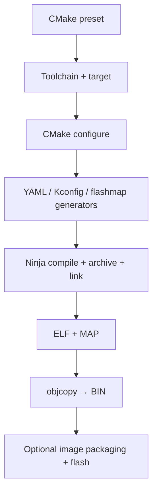
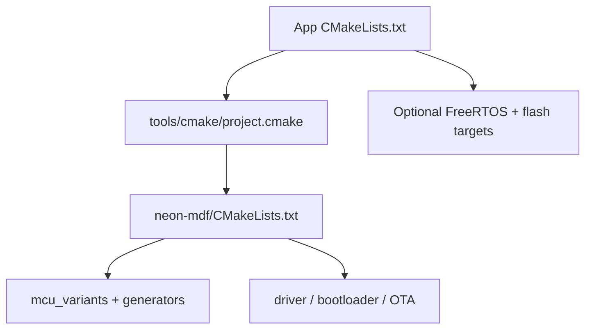
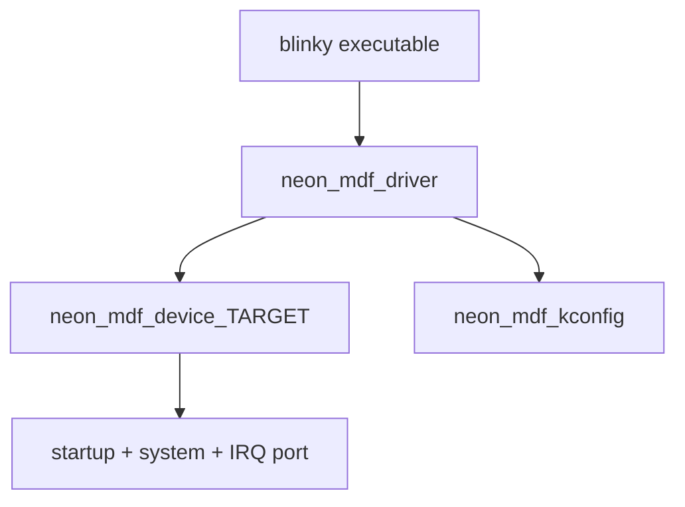
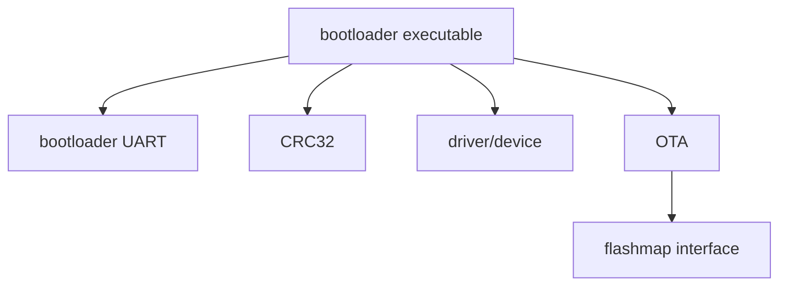

# Phân tích toàn bộ CMake và hệ thống build của NEON_MDF

## 0. Phạm vi và cách đọc tài liệu này

Tài liệu này phân tích tĩnh toàn bộ các file CMake trong SDK đã giải nén, cùng các file trực tiếp tham gia vào configure, generate, compile, link, tạo image, flash và tích hợp VS Code.

- Không sửa source code của SDK.
- Không chạy lệnh flash.
- Không coi địa chỉ hoặc thông số trong YAML/generated file là dữ liệu silicon đã được xác minh độc lập. Tài liệu chỉ mô tả cách build system sử dụng các giá trị đó.
- Các đường dẫn trong tài liệu là đường dẫn tương đối tính từ `survey/neon-mdf_gpt/`.
- Ba file dưới `examples/Blinky/build/WEACT_F412/CMakeFiles/4.4.2/` là output do CMake sinh, không phải source build script.
- Các file dưới `neon-mdf/rtos/FreeRTOS-Kernel/` là third-party/upstream. NEON_MDF chỉ dùng một phần trong số đó.

## 1. Bức tranh tổng thể

Trong SDK này, CMake không trực tiếp “biên dịch mọi thứ” ngay khi đọc `CMakeLists.txt`. Quá trình chia thành năm pha:

1. **Chọn preset và toolchain**: `CMakePresets.json` chọn target, Ninja, build directory và toolchain file.
2. **Configure**: CMake đọc các `CMakeLists.txt`/`.cmake`, chạy generator Python, tạo target graph và ghi `CMakeCache.txt`/`build.ninja`.
3. **Generate dữ liệu build**: YAML sinh device/startup/linker/SVD; Kconfig sinh `sdkconfig.h`/`sdkconfig.cmake`; flashmap sinh header/CMake fragment/linker scripts.
4. **Build**: Ninja gọi compiler, assembler, archiver và linker để tạo `.o`, `.a`, `.elf`, `.map`.
5. **Post-build/flash**: `objcopy` tạo `.bin`; các custom target đóng gói image header/OTA rồi gọi OpenOCD hoặc UART flasher.



Lệnh tối thiểu từ thư mục một application, ví dụ `examples/Blinky/`:

```bash
cmake --preset WEACT_F412
cmake --build --preset WEACT_F412
```

Lệnh thứ nhất là **configure/generate**. Lệnh thứ hai mới là **compile/link**. CLI `neon_mdf.py` và extension VS Code đều chỉ bọc lại hai dạng lệnh này.

## 2. Các khái niệm CMake cần hiểu trước

### 2.1 Target

Target là một đơn vị build có tên. SDK tạo ba loại chính:

- `STATIC`: tạo thư viện `.a`, ví dụ `neon_mdf_driver`.
- `INTERFACE`: không tạo binary; chỉ truyền include path, macro hoặc dependency, ví dụ `neon_mdf_kconfig`.
- `EXECUTABLE`: tạo firmware `.elf`, ví dụ `blinky`, `bootloader`.

Custom target như `menuconfig`, `flash_jtag` không tạo ELF; nó chạy command được khai báo bằng `add_custom_target()`.

### 2.2 `PRIVATE`, `PUBLIC`, `INTERFACE`

- `PRIVATE`: chỉ target hiện tại dùng dependency/flag.
- `PUBLIC`: target hiện tại dùng và target link tới nó cũng kế thừa.
- `INTERFACE`: bản thân target không compile; consumer kế thừa.

Ví dụ `neon_mdf_driver PUBLIC neon_mdf_device_<TARGET>` khiến driver và app link driver đều kế thừa include path device header cùng cờ CPU.

### 2.3 Cache và environment

- Cache variable sống trong `build/<TARGET>/CMakeCache.txt`, ví dụ `NEON_MDF_TARGET`.
- Environment variable sống trong process shell, ví dụ `NEON_MDF_PATH`, `NEON_MDF_SERIAL_PORT`.
- `set(... CACHE STRING ...)` giữ giá trị qua các lần configure.
- Đổi toolchain/target trong một build directory cũ dễ gây cache bẩn; thiết kế preset tránh việc đó bằng mỗi target một thư mục riêng.

### 2.4 Scope và `PARENT_SCOPE`

Mỗi `function()` có scope riêng; mỗi `add_subdirectory()` cũng tạo directory scope. Vì vậy các biến như linker script phải được đẩy qua nhiều tầng:

```text
neon_mdf_configure_target() function
  → neon-mdf/CMakeLists.txt directory scope
    → application CMakeLists.txt directory scope
```

Đây là lý do code có nhiều `set(... PARENT_SCOPE)` liên tiếp.

### 2.5 Generator expression

Cú pháp `$<TARGET_FILE:name>` chỉ được đánh giá ở generate/build time, không phải lúc CMake đang đọc file. Nó cho CMake biết chính xác đường dẫn artifact của target trên từng platform.

## 3. Entry point: CMake bắt đầu ở đâu?

Mỗi application là một CMake project độc lập. Entry point thật là `CMakeLists.txt` của app, không phải `neon-mdf/CMakeLists.txt`.

Ví dụ `examples/Blinky/CMakeLists.txt` thực hiện:

1. `cmake_minimum_required(VERSION 3.21)`.
2. `project(blinky C ASM)` bật ngôn ngữ C và Assembly.
3. Đảm bảo environment `NEON_MDF_PATH` tồn tại.
4. `include(.../tools/cmake/project.cmake)` để nạp toàn bộ SDK.
5. Dựa trên `NEON_MDF_BOOTLOADER_ENABLED`, tạo một firmware whole-flash hoặc nhiều firmware bootloader/factory/OTA.

Quan hệ include/subdirectory chính:



## 4. Phân tích từng file CMake do NEON_MDF sở hữu

### 4.1 `neon-mdf/tools/cmake/project.cmake`

Đây là public entry point duy nhất mà app cần include.

Nội dung chính:

- Dòng 25–32: resolve `NEON_MDF_PATH` theo ưu tiên biến CMake → environment → suy từ vị trí file.
- Dòng 38–45: resolve `NEON_MDF_TARGET`, mặc định là `FU2`, rồi ghi vào cache.
- Dòng 47–50: kiểm tra target có trong `NEON_MDF_KNOWN_TARGETS`.
- Dòng 52: `add_subdirectory(${NEON_MDF_PATH} neon-mdf-build)` kéo SDK vào project của app.
- `neon_mdf_add_executable()`: tạo firmware whole-flash.
- `neon_mdf_add_app_executable()`: tạo app nằm sau bootloader bằng `_APP.ld`.
- `neon_mdf_add_bootloader_executable()`: tạo bootloader bằng source do SDK cung cấp và `_BOOTLOADER.ld`.

Ba helper executable đều thực hiện cùng chuỗi:

```text
add_executable
→ link library
→ gắn linker script bằng -T
→ yêu cầu relink khi linker script thay đổi
→ post-build objcopy -O binary
→ in size report
```

Output trực tiếp là `<name>.elf`, `<name>.elf.map` và `<name>.elf.bin`. Vì `$<TARGET_FILE:name>` đã mang suffix `.elf`, lệnh nối thêm `.map`/`.bin` tạo tên có dạng `.elf.map` và `.elf.bin`, không phải `<name>.map`/`<name>.bin` thuần.

Không có target tạo Intel HEX; không có `objcopy -O ihex`.

### 4.2 `neon-mdf/CMakeLists.txt`

Đây là root của phần SDK nhưng không phải top-level project độc lập.

Luồng thực tế:

1. Kiểm tra `NEON_MDF_TARGET`.
2. Include `mcu_variants.cmake` và gọi `neon_mdf_configure_target()`.
3. Đẩy device target, linker script, arch và bootloader metadata lên app scope.
4. Chọn `flashmap.<TARGET>.csv`; nếu không có thì fallback `flashmap.csv`.
5. Nếu target có bootloader và app có flashmap, gọi `neon_mdf_process_flashmap()`.
6. Với family được hỗ trợ, chạy Kconfig, thêm driver, rồi thêm bootloader nếu cần.

Điểm quan trọng về thứ tự: flashmap được xử lý trước `components/bootloader` để target `neon_mdf_ota` có thể tồn tại trước khi bootloader executable link nó.

### 4.3 `neon-mdf/cmake/mcu_variants.cmake`

Đây là registry target và factory tạo device library.

Registry hiện có:

| Target | Arch variable | Family | Thuộc tính thêm |
|---|---|---|---|
| `FU2` | `cortex-m0` | `FU2` | không có bootloader fragment |
| `WEACT_F412` | `cortex-m4` | `WEACT_F412` | `FPU=ON` |
| `CH32V003F4P6` | `riscv-rv32ec` | `CH32V003` | vendor `WCH`, ABI `ilp32e` |

`neon_mdf_configure_target()` làm bốn việc lớn:

1. Tìm `python3` và chạy `mcu-description/tools/generate.py --device <target>` ngay trong pha configure.
2. Dispatch theo `arch` sang Cortex-M hoặc RISC-V.
3. Tạo `neon_mdf_device_<TARGET>` gồm `system_*.c`, startup assembly, IRQ port và, với RISC-V, `riscv_soft_math.c`.
4. Nếu generated bootloader fragment tồn tại, include nó và xuất đường dẫn linker script whole-flash/bootloader/app cùng metadata memory/erase.

Device library là nơi phát tán cờ CPU, include path và macro target ra toàn bộ dependency graph.

### 4.4 `neon-mdf/cmake/arch/cortex-m.cmake`

Định nghĩa `neon_mdf_apply_cortex_m_arch(target, mcpu, [fpu])`.

- Luôn thêm `-mcpu=<core>` và `-mthumb` cho compile lẫn link.
- Không FPU: `-mfloat-abi=soft`.
- Có FPU: `-mfloat-abi=hard -mfpu=fpv4-sp-d16`.

Đặt flag ở `PUBLIC` để target consumer kế thừa ABI. Đây là điều cần thiết: object build với hard-float và soft-float không được link lẫn tùy tiện.

### 4.5 `neon-mdf/cmake/arch/riscv.cmake`

Định nghĩa `neon_mdf_apply_riscv_arch(target, isa, abi)`.

- Compile và link cùng `-march=${isa}_zicsr`.
- Compile và link cùng `-mabi=${abi}`.
- Tự thêm extension `zicsr` vì startup dùng lệnh CSR.

Với CH32 hiện tại, giá trị được truyền từ registry là ISA `rv32ec` và ABI `ilp32e`.

### 4.6 `neon-mdf/cmake/toolchain/arm-none-eabi.cmake`

Vai trò: cho CMake biết đây là cross-compilation bare-metal ARM.

- `CMAKE_SYSTEM_NAME Generic`: không có host OS target.
- `CMAKE_SYSTEM_PROCESSOR arm`.
- `CMAKE_TRY_COMPILE_TARGET_TYPE STATIC_LIBRARY`: CMake kiểm tra compiler bằng library, tránh cố chạy/link executable trên host.
- Prefix mặc định `arm-none-eabi-`.
- Chọn `gcc`, `g++`, `objcopy`, `objdump`, `size`.
- Suffix executable `.elf`.
- C/C++ dùng function/data sections để linker garbage-collect section không dùng.
- C++ tắt RTTI và exception.
- Linker dùng newlib-nano, nosys stubs, `--gc-sections`, `--print-memory-usage`.

Lưu ý: app hiện khai `project(... C ASM)`, chưa enable `CXX`. Việc toolchain đặt `CMAKE_CXX_COMPILER` không tự động làm `.cpp` build được; app dùng C++ phải khai thêm `CXX` trong `project()`.

### 4.7 `neon-mdf/cmake/toolchain/riscv-none-elf.cmake`

Vai trò tương tự bản ARM nhưng cho toolchain bare-metal RISC-V.

- Prefix mặc định là `riscv64-elf-`, dù output có thể là RV32 nhờ multilib/flags.
- Dùng `-ffreestanding` ở compile.
- Không dùng newlib specs; linker dùng `-nostdlib -ffreestanding`.
- Suffix `.elf`.

Comment dòng 52–63 nói `libgcc` sẽ được link từ device target, nhưng code hiện tại trong `mcu_variants.cmake` không link `gcc`; thay vào đó nó compile `riscv_soft_math.c`. Đây là comment lỗi thời so với implementation hiện tại.

### 4.8 `neon-mdf/cmake/kconfig.cmake`

Định nghĩa `neon_mdf_process_kconfig(APP_DIR, [KCONFIG_FILE])`.

Configure-time flow:

1. Set environment `NEON_MDF_APP_KCONFIG=<app>/Kconfig`.
2. Tìm `python3`.
3. Kiểm tra import được `kconfiglib`.
4. Chạy `tools/kconfig/gen_config_header.py`.
5. Sinh `build/<target>/config/sdkconfig.h` và `sdkconfig.cmake`.
6. Include `sdkconfig.cmake` để CMake có các biến `CONFIG_*`.
7. Tạo `neon_mdf_kconfig` INTERFACE library chứa include path `config/`.
8. Tạo custom target `menuconfig`.
9. Đẩy mọi biến `CONFIG_*` lên caller scope.

`menuconfig` chỉ sửa `sdkconfig`; sau khi lưu phải configure lại để source selection và `sdkconfig.h` cập nhật.

### 4.9 `neon-mdf/cmake/flashmap.cmake`

Định nghĩa `neon_mdf_process_flashmap(APP_DIR, [CSV_PATH])`.

Nó biến partition CSV của app thành ba loại output trong `build/<target>/flashmap/`:

- `flashmap.h`: macro C.
- `flashmap.cmake`: biến CMake.
- `<partition>.ld`: một linker script cho mỗi partition `type=app`.

Script Python được truyền flash base/size, app base, image header size, RAM, erase sector, target và architecture. Nếu generator lỗi, configure dừng bằng `FATAL_ERROR`.

Sau generation, file này:

- include CMake fragment;
- tạo `neon_mdf_flashmap` INTERFACE library;
- add component OTA;
- xuất danh sách biến `NEON_MDF_FLASHMAP_*` động lên scope cha.

Comment dòng 111–113 nói hàm được gọi trực tiếp từ app, nhưng code thật gọi nó từ `neon-mdf/CMakeLists.txt`. Implementation vẫn hoạt động vì `neon-mdf/CMakeLists.txt` tiếp tục propagate thêm một tầng; comment đó đã lỗi thời.

### 4.10 `neon-mdf/cmake/freertos.cmake`

Định nghĩa `neon_mdf_add_freertos(TARGET_NAME, CONFIG_DIR)`.

Nó là adapter giữa target NEON_MDF và CMake chính thức của FreeRTOS:

- FU2 → `FREERTOS_PORT=GCC_ARM_CM0`.
- WEACT_F412 → `GCC_ARM_CM4F` và cờ FPU.
- CH32V003F4P6 → `GCC_RISC_V_GENERIC` + `RISCV_no_extensions`.
- Tạo `freertos_config` INTERFACE target trỏ tới `FreeRTOSConfig.h`.
- Chọn `FREERTOS_HEAP=4`.
- Add FreeRTOS-Kernel subdirectory.
- Áp đúng cờ arch/ABI cho cả `freertos_kernel` và `freertos_kernel_port`.
- Với RISC-V, thêm libc shim vì toolchain không có libc.

Hàm guard `if(TARGET freertos_kernel) return()` nên chỉ wire kernel một lần trong một configure.

### 4.11 `neon-mdf/cmake/flash_targets.cmake`

File này không tham gia compile bình thường; nó tạo các custom target build + package + flash.

`neon_mdf_add_flash_targets(bootloader_target, app_target, openocd_cfg)` tạo:

- `serial_monitor`: chạy `python3 -m serial.tools.miniterm`.
- `flash_jtag`: build dependency, đóng gói app blob, gọi OpenOCD ghi bootloader và app tại hai địa chỉ riêng. Nếu có OTA metadata, ghi thêm bản factory metadata.
- `flash_uart_stm32`: đóng gói app blob, reset qua OpenOCD rồi gọi `stm32_uart_flash_firmware.py` ghi hai vùng trong một session UART.
- `neon_mdf_debug_targets.txt`: manifest tên bootloader/factory cho extension debug.

`neon_mdf_add_ota_flash_target()` tạo `flash_ota`:

- tạo OTA app blob;
- tạo `otadata_pending.bin`;
- dùng OpenOCD ghi slot OTA và metadata;
- append executable OTA vào debug manifest.

`DEPENDS` đảm bảo target executable được build trước khi package/flash. `USES_TERMINAL` dành terminal tương tác. `VERBATIM` yêu cầu CMake escape argument đúng.

Rủi ro coupling: cả hai function gọi `find_program(openocd REQUIRED)` ngay lúc configure. Vì vậy một người chỉ muốn build firmware bootloader-enabled vẫn phải có OpenOCD trong PATH, dù không hề gọi target flash.

### 4.12 `neon-mdf/components/driver/CMakeLists.txt`

Tạo static library `neon_mdf_driver`.

- Chọn đúng GPIO backend theo family.
- Chỉ thêm flash backend nếu bootloader enabled.
- UART/I2C hiện chỉ được compile cho family FU2 và còn phụ thuộc `CONFIG_NEON_MDF_DRIVER_*`.
- Public include directory là root `components/driver`.
- Public-link device target và Kconfig target để kế thừa header, CPU flags và `sdkconfig.h`.

Kết quả là application chỉ link một library nhưng kéo được dependency xuyên suốt.

### 4.13 `neon-mdf/components/bootloader/CMakeLists.txt`

Tạo hai static library:

- `neon_mdf_crc32`: CRC chung.
- `neon_mdf_bootloader_uart`: UART implementation theo family.

`neon_bootloader_main.c` và backend arch không đóng thành `.a`; chúng được trả về qua `NEON_MDF_BOOTLOADER_MAIN_SOURCES` rồi compile trực tiếp vào executable bootloader. Cách này tránh vòng phụ thuộc archive giữa startup cần `main()` và bootloader cần symbol device.

### 4.14 `neon-mdf/components/ota/CMakeLists.txt`

Tạo `neon_mdf_ota` từ `neon_ota.c`, public-link:

- `neon_mdf_driver` để đọc/ghi flash;
- `neon_mdf_crc32`;
- `neon_mdf_flashmap` để lấy macro partition.

Component này chỉ được add khi app có flashmap.

### 4.15 Generated bootloader fragments

Hai file:

- `neon-mdf/mcu-description/generated/WEACT_F412_bootloader.cmake`
- `neon-mdf/mcu-description/generated/CH32V003F4P6_bootloader.cmake`

Đây là bridge từ YAML/Python sang CMake. Mỗi file set:

- `NEON_MDF_BOOTLOADER_ENABLED`;
- bootloader size;
- image header size;
- app base;
- flash size;
- RAM base/size;
- erase sector description.

Không sửa tay; `generate.py` ghi lại khi configure.

Rủi ro: nếu xóa section `bootloader:` khỏi YAML, `generate.py` hiện không xóa fragment cũ. Vì CMake chỉ kiểm tra `EXISTS`, fragment stale có thể tiếp tục bật bootloader sai. Generator nên chủ động xóa fragment/partition linker scripts không còn hợp lệ.

## 5. CMakeLists của từng example và template

### 5.1 `examples/Blinky/CMakeLists.txt`

- FU2: gọi `neon_mdf_add_executable(blinky ...)`, whole-flash, một executable.
- Target có bootloader: tạo `bootloader`, `blinky` factory và `blinky_ota`.
- Helper `_blinky_add_variant()` dùng cùng `Src/main.c` nhưng khác linker script và `NEON_OTA_APP_VERSION`.
- Tạo flash targets và OTA flash target.

Code ở đây lặp lại logic add executable/post-build thay vì tái dùng một helper public nhận linker script tùy ý. Đây là duplication với FreeRTOS_Blinky và OTA_Demo.

### 5.2 `examples/FreeRTOS_Blinky/CMakeLists.txt`

Ngoài luồng giống Blinky, file này gọi `neon_mdf_add_freertos()` trước khi tạo executable.

- FU2: một whole-flash app + FreeRTOS.
- WEACT có flashmap: bootloader + factory + OTA.
- CH32 có bootloader nhưng không có flashmap dành cho project này: bootloader + một app cố định, không A/B OTA.

### 5.3 `examples/OTA_Demo/CMakeLists.txt`

- Bắt buộc bootloader enabled.
- Tạo `bootloader` và ba app variants: factory, OTA tốt, OTA không confirm.
- Hai OTA variants cùng linker script slot OTA nhưng khác macro compile.
- Chỉ đăng ký `ota_demo_ota` với target `flash_ota`; bản bad phải đổi thủ công theo comment.

File chỉ check bootloader enabled, không check target là WEACT. CH32 cũng có bootloader nên qua check đầu, sau đó flashmap WEACT-sized sẽ bị generator từ chối vì capacity/alignment. Thông báo lỗi đầu file chưa phản ánh đầy đủ điều kiện thật.

### 5.4 `neon-mdf/tools/templates/CMakeLists.txt`

Template bare-metal dùng hai token:

- `__APP_NAME__`.
- `__NEON_MDF_RELATIVE_PATH__`.

App mới có bootloader tạo bootloader + một fixed app; không tạo OTA/flashmap mặc định.

### 5.5 `neon-mdf/tools/templates_freertos/CMakeLists.txt`

Giống template bare-metal nhưng thêm FreeRTOS adapter và link `freertos_kernel`.

### 5.6 Các `CMakePresets.json` của app/template

Ba example và hai template đều là file mỏng chỉ include `neon-mdf/cmake/presets/targets.json`. Template dùng token relative path để hoạt động khi app nằm ngoài `examples/`.

### 5.7 `neon-mdf/cmake/presets/targets.json`

Nguồn preset tập trung cho cả SDK:

- Generator: Ninja.
- Binary dir: `${sourceDir}/build/<TARGET>`.
- Build type: Debug.
- Export `compile_commands.json`.
- FU2/WEACT dùng ARM toolchain.
- CH32 dùng RISC-V toolchain.
- Có configure preset và build preset trùng tên cho từng target.

Extension và CLI đọc chính file này để khám phá target; thêm target vào registry nhưng quên thêm preset sẽ khiến UI/CLI không thấy target đó.

## 6. Kconfig, sdkconfig và flashmap liên quan build

### 6.1 `neon-mdf/Kconfig`

Root menu của SDK. Nó `rsource` driver Kconfig và `osource` Kconfig riêng của app thông qua environment `NEON_MDF_APP_KCONFIG`.

### 6.2 `neon-mdf/components/driver/Kconfig`

Khai hai bool:

- `NEON_MDF_DRIVER_UART`, mặc định `y`.
- `NEON_MDF_DRIVER_I2C`, mặc định `y`.

Với FU2, chúng quyết định source `.c` có được thêm vào `neon_mdf_driver` hay không. Với family khác, guard family vẫn chặn source dù config đang `y`.

### 6.3 App/template Kconfig

- `examples/Blinky/Kconfig` thêm `BLINKY_DELAY_LOOPS`.
- Hai template Kconfig chỉ là skeleton/comment, có thể xóa vì root dùng `osource`.
- FreeRTOS_Blinky và OTA_Demo không có app Kconfig riêng.

### 6.4 `sdkconfig` và `sdkconfig.old`

`sdkconfig` là input có version control và cũng bị `gen_config_header.py` ghi lại trong configure để bổ sung default/xóa option cũ. `sdkconfig.old` trong Blinky là backup do menuconfig tạo, không được CMake include trực tiếp.

### 6.5 Các `flashmap*.csv`

- `examples/Blinky/flashmap.csv`: layout mặc định, dùng khi không có target override.
- `examples/Blinky/flashmap.CH32V003F4P6.csv`: override riêng cho CH32.
- `examples/FreeRTOS_Blinky/flashmap.WEACT_F412.csv`: chỉ WEACT có OTA.
- `examples/OTA_Demo/flashmap.csv`: layout OTA demo.

CMake ưu tiên file target-specific rồi mới fallback. CSV không có cột offset; offset được tính tuần tự từ app base. Mỗi `type=app` dành một header slot trước vector/code.

## 7. Python generator và image tools trực tiếp phục vụ CMake

### 7.1 `mcu-description/tools/generate.py`

Được gọi bởi `mcu_variants.cmake` ở configure time.

Input: `devices/<TARGET>.yaml`.

Output Cortex-M:

- device header;
- `mcu_device.h` alias;
- whole-flash linker script;
- startup/vector assembly;
- SVD;
- nếu có bootloader: bootloader/app linker scripts và CMake fragment.

Output RISC-V tương tự nhưng đặt dưới `arch/RISCV/Device/<vendor>/<family>` và dùng RISC-V backends.

### 7.2 `mcu_desc/loader.py` và `model.py`

- `model.py` định nghĩa dataclass/model cho field, register, peripheral, memory, interrupt, CPU, bootloader và erase sector.
- `loader.py` parse YAML, yêu cầu field bắt buộc và chạy sanity checks: overlap, register layout, erase coverage, alignment/bootloader constraints.

Hai file này không gọi compiler nhưng quyết định configure thành công hay thất bại.

### 7.3 Backend generator files

Cortex-M:

- `gen_cmsis_header.py`: device header, IRQ enum, register struct, peripheral macros.
- `gen_linker_script.py`: whole-flash và bootloader/app linker scripts.
- `gen_startup_vector.py`: startup, vector table, weak handlers.
- `gen_svd.py`: SVD cho debugger; dùng chung cho RISC-V.
- `core_info.py`: ánh xạ core sang CMSIS core include/metadata dùng khi sinh header.

RISC-V:

- `gen_riscv_header.py`.
- `gen_linker_script.py`.
- `gen_startup.py`.

Chúng ghi output vào source tree trong configure. Điều này làm configure có side effect và có thể gây race nếu sau này hai device cùng family cùng ghi một `mcu_device.h` alias trong hai build song song.

### 7.4 `tools/kconfig/gen_config_header.py`

Đọc Kconfig + sdkconfig bằng `kconfiglib`, ghi lại sdkconfig, rồi sinh:

- C header với `#define CONFIG_*`.
- CMake fragment với `set(CONFIG_* ON/OFF/value)`.

Nhờ đó cùng một config điều khiển cả preprocessor C lẫn source selection CMake.

### 7.5 `tools/gen_flashmap.py`

Các bước:

1. Parse CSV bốn cột.
2. Chặn tên trùng/type sai/size không phải hex.
3. Bắt buộc đúng ba partition `app`, `app_ota`, `otadata` với type/subtype tương ứng.
4. Tính base/vector base/code size.
5. Kiểm tra không vượt flash.
6. Nếu có erase map, kiểm tra boundary partition trùng erase-sector boundary.
7. Sinh header, CMake fragment và linker script theo architecture backend.

Không có thông tin hardware mới được script tự đoán; mọi base/size/erase input đi từ generated YAML fragment hoặc CSV app.

### 7.6 `tools/build_full_image.py`

Chứa logic `build_header()` và `build_app_blob()`:

- header 16 byte: magic, version, image size, CRC32;
- padding `0xFF` tới hết header slot;
- nối app bytes.

`main()` của file có thể ghép bootloader + padding + app blob thành một image liên tục. Tuy nhiên CMake hiện không gọi `main()` này. `flash_targets.cmake` đã chuyển sang ghi bootloader và app ở hai địa chỉ riêng; chỉ `build_app_blob()` còn được `build_ota_image.py` import. Docstring nói full image được cả hai flash path dùng là lỗi thời.

### 7.7 `tools/build_ota_image.py`

Wrapper được CMake gọi thật. Nó đọc app BIN, dùng `build_app_blob()`, rồi ghi `[header slot][app]` để flash vào factory hoặc OTA slot.

Tên file là “OTA” nhưng code dùng nó cho cả factory app blob trong `flash_jtag`/`flash_uart_stm32` và OTA blob trong `flash_ota`.

### 7.8 `tools/build_otadata_image.py`

Sinh struct metadata 20 byte gồm magic, active slot, state, boot attempts và CRC32. CMake gọi với:

- `0 0 0` cho factory metadata khi flash JTAG full image.
- `1 1 0` cho OTA pending.

### 7.9 `tools/stm32_uart_flash_firmware.py`

Không tham gia compile/link. Custom target `flash_uart_stm32` gọi nó sau build/package để giao tiếp STM32 ROM bootloader, mass erase và ghi nhiều cặp `(file, address)` trong một UART session.

### 7.10 `tools/neon_mdf.py`

CLI cấp cao, tương đương wrapper kiểu `idf.py`:

- Đọc target từ `-t`, state file hoặc preset.
- `ensure_configured()` chỉ gọi `cmake --preset` nếu chưa có `CMakeCache.txt`.
- `build` gọi `cmake --build --preset`.
- flash/monitor/menuconfig gọi đúng custom target CMake.
- Nhiều action chạy tuần tự và dừng ở lỗi đầu tiên.

Hạn chế: nếu `CMakeCache.txt` tồn tại nhưng configure trước đó thất bại, CLI cho rằng build dir đã configured. Snapshot trong ZIP đúng trường hợp này: có cache nhưng thiếu `build.ninja` do không tìm thấy `python3`.

### 7.11 `neon-mdf/export.sh`

Chỉ export `NEON_MDF_PATH` vào shell hiện tại. Phải `source`; chạy thành subprocess thì environment mất khi process kết thúc. Script không cài CMake, Ninja, compiler, Python package hay OpenOCD.

## 8. Extension VS Code liên quan build

### 8.1 `vscode-extension/src/presets.ts`

Đọc `CMakePresets.json` và include một cấp để lấy danh sách target. Không parse `mcu_variants.cmake`, không hỗ trợ đầy đủ preset inheritance/condition.

### 8.2 `src/sdkPath.ts`

Resolve SDK root từ setting global `neonMdf.sdkPath` hoặc quy ước relative path. Khi setting có giá trị, `sdkPathEnv()` truyền `NEON_MDF_PATH` xuống process CMake.

### 8.3 `src/cmakeRunner.ts`

Điểm duy nhất extension trực tiếp gọi CMake:

- configure: `cmake --preset <preset>`;
- build/custom target: `cmake --build --preset <preset> [--target ...]`.

Nó dùng VS Code Task API và trả exit code thật cho command phía trên.

### 8.4 `src/configure.ts`

Đảm bảo build dir có `CMakeCache.txt` và CMake File API reply. Nó ghi query trước configure để CMake trả codemodel.

### 8.5 `src/cmakeFileApi.ts`

Không parse `CMakeCache.txt` hoặc đoán tên ELF. Nó dùng CMake File API codemodel v2 để lấy các target `EXECUTABLE` và artifact path thật. Debug UI nhờ đó tự thấy `bootloader`, `blinky`, `blinky_ota`, v.v.

### 8.6 `src/commands/build.ts`

Validate workspace/target, ensure configure, rồi build default target `all`.

### 8.7 `src/commands/menuconfig.ts`

Wrapper mỏng gọi target CMake `menuconfig`; logic Kconfig thật ở `kconfig.cmake`.

### 8.8 `src/commands/flash.ts`

Map transport UI sang custom target:

- JTAG/SWD → `flash_jtag`.
- UART → `flash_uart_stm32` và truyền `NEON_MDF_SERIAL_PORT`.

Nó kiểm tra OpenOCD cfg trước khi chạy, điều mà CLI không làm sớm.

### 8.9 `src/commands/buildFlashMonitor.ts`

Gọi lại flash command, sau đó gọi custom target `serial_monitor`. Tên command nói “build + flash” nhưng build đã được đảm bảo gián tiếp bởi dependency của flash target.

### 8.10 `src/commands/debug.ts`, `src/debugArch.ts`

Debug command:

- ensure configure;
- đọc executable từ File API;
- build/flash đúng target trước debug;
- đọc `neon_mdf_debug_targets.txt` để phân biệt bootloader/factory/OTA;
- dùng OpenOCD cfg và optional SVD.

`debugArch.ts` hiện chỉ có Cortex-M profile. CH32V003F4P6 đã tồn tại nhưng extension chưa có RISC-V debug profile; comment trong file vẫn nói RISC-V là tương lai, nên phần này lỗi thời.

### 8.11 `src/commands/createApp.ts`

Copy template bare-metal hoặc FreeRTOS, thay app name và relative SDK path. File này tạo `CMakeLists.txt`/`CMakePresets.json` đúng theo build model hiện tại.

### 8.12 Extension build riêng: `package.json`, `tsconfig.json`, `esbuild.js`

Đây là build system của extension, tách biệt firmware CMake:

- `npm run typecheck` → `tsc --noEmit`.
- `npm run compile` → esbuild bundle `src/extension.ts` thành `dist/extension.js` có sourcemap.
- `npm run package` → production bundle minified.
- `npm run vsix` → `vsce package`.
- `serialport` và native binding được externalize khỏi bundle, nên phải có đúng files trong VSIX.

Snapshot đã khảo sát trước đó cho thấy `dist/extension.js` trong source không trùng bản nằm trong `neon-mdf-tools-0.1.0.vsix`; VSIX chưa thể coi là package của source hiện tại.

## 9. Các file CMake third-party của FreeRTOS

### 9.1 `rtos/FreeRTOS-Kernel/CMakeLists.txt`

CMake root chính thức của kernel:

- yêu cầu consumer tạo `freertos_config`;
- yêu cầu/chọn `FREERTOS_PORT`;
- tạo `freertos_kernel` static library;
- add `include/` và `portable/`;
- thêm core source `croutine.c`, `event_groups.c`, `list.c`, `queue.c`, `stream_buffer.c`, `tasks.c`, `timers.c` và heap đã chọn;
- link config/include/port targets.

NEON_MDF chuẩn bị input cho file này trong `cmake/freertos.cmake`.

### 9.2 `rtos/FreeRTOS-Kernel/include/CMakeLists.txt`

Tạo `freertos_kernel_include` INTERFACE target để phát tán kernel public include directory và link `freertos_config`.

### 9.3 `rtos/FreeRTOS-Kernel/portable/CMakeLists.txt`

File lớn nhất, tạo:

- `freertos_kernel_port` OBJECT library với source được chọn bằng generator expression theo `FREERTOS_PORT`;
- `freertos_kernel_port_headers` INTERFACE target với include directory tương ứng;
- dependency platform-specific.

Đối với NEON_MDF chỉ ba nhánh thực sự liên quan: `GCC_ARM_CM0`, `GCC_ARM_CM4F`, `GCC_RISC_V_GENERIC`. Hàng trăm nhánh khác là khả năng upstream, không phải NEON_MDF hỗ trợ các MCU đó.

### 9.4 RISC-V chip extension fragments

- `portable/GCC/RISC-V/chip_extensions.cmake`: validate/chọn `FREERTOS_RISCV_EXTENSION` cho GCC generic port.
- `portable/IAR/RISC-V/chip_extensions.cmake`: cùng vai trò cho IAR; NEON_MDF không dùng IAR.

NEON_MDF set `RISCV_no_extensions` trước khi add kernel.

### 9.5 FreeRTOS example CMake files

- `examples/cmake_example/CMakeLists.txt`: ví dụ consumer tạo `freertos_config`, chọn heap/port, add kernel và link app.
- `examples/coverity/CMakeLists.txt`: project host/template dành cho Coverity.

Hai file này không được NEON_MDF add vào firmware build.

### 9.6 RP2040 CMake files

- `portable/ThirdParty/GCC/RP2040/CMakeLists.txt`.
- `FreeRTOS_Kernel_import.cmake`.
- `library.cmake`.
- `pico_sdk_import.cmake`.

Đây là integration riêng cho Raspberry Pi Pico SDK: tìm/import kernel/Pico SDK và tạo các INTERFACE library/heap variants. NEON_MDF không include các file này và không dùng target RP2040.

## 10. CMake-generated files trong ZIP

Thư mục `examples/Blinky/build/WEACT_F412/` là một configure dang dở từ máy Windows khác.

### 10.1 `CMakeFiles/4.4.2/CMakeCCompiler.cmake`

CMake tự ghi kết quả nhận diện ARM GCC 10.2.1, ELF, pointer 32-bit, little-endian, implicit include paths và tool paths.

### 10.2 `CMakeASMCompiler.cmake`

Ghi assembler compiler và binutils mà CMake đã nhận diện.

### 10.3 `CMakeSystem.cmake`

Ghi host Windows, target `Generic/arm`, toolchain file và `CMAKE_CROSSCOMPILING=TRUE`.

### 10.4 `CMakeCache.txt` và configure log

Cache cho thấy:

- generator Ninja;
- target WEACT_F412;
- ARM GCC lấy từ một VS Code extension;
- Ninja/OpenOCD có trong PATH trên máy tạo ZIP;
- `NEON_MDF_PYTHON3=NOTFOUND`.

Configure log kết thúc ở bước tìm `python3`; không có `build.ninja`, ELF hoặc BIN. Vì vậy đây không phải build artifact hoàn chỉnh và không nên copy sang máy khác. Các absolute path bên trong cũng chỉ hợp lệ trên máy đã tạo cache.

## 11. Dependency graph của target build

Ví dụ firmware bare-metal whole-flash:



Ví dụ bootloader + OTA:



FreeRTOS app thêm `freertos_kernel`, target này kéo `freertos_kernel_port`, `freertos_kernel_include` và `freertos_config`.

## 12. Output thực tế theo loại target

### Whole-flash application

- `<app>.elf`
- `<app>.elf.map`
- `<app>.elf.bin`

Link bằng `<TARGET>_FLASH.ld`.

### Bootloader-enabled, fixed single app

- `bootloader.elf/.map/.bin`
- `<app>.elf/.map/.bin`

Bootloader link `_BOOTLOADER.ld`; app link `_APP.ld`.

### Flashmap/OTA application

- bootloader ELF/BIN;
- factory ELF/BIN;
- OTA ELF/BIN;
- generated `flashmap.h`, `flashmap.cmake`, `app.ld`, `app_ota.ld`;
- khi gọi flash target: app blob và otadata binary.

Không có `.hex` trong bất kỳ nhánh nào.

## 13. Những điểm thiếu, mâu thuẫn hoặc nên cải thiện

### Mức cao

1. **FU2 build inputs vẫn placeholder**: build system dùng YAML/generated output nhưng không làm các giá trị FU2 trở thành dữ liệu silicon hợp lệ.
2. **OpenOCD bị bắt buộc quá sớm**: `find_program(... REQUIRED)` trong flash helper chạy ở configure, khiến build-only cũng phụ thuộc OpenOCD.
3. **Windows Python naming**: CMake chỉ tìm `python3`; cache trong ZIP chứng minh máy Windows không có command này dù có thể có `python.exe`/Python Launcher.
4. **CH32 flash/debug chưa wire**: không có `CH32V003F4P6_openocd.cfg`, không có wlink target, extension debug chỉ Cortex-M.
5. **Generated fragment stale**: generator không xóa bootloader fragment cũ khi YAML bỏ bootloader.

### Mức trung bình

6. `build_full_image.py` docstring không khớp pipeline hai-vùng hiện tại.
7. RISC-V toolchain comment về `libgcc` không khớp `riscv_soft_math.c` hiện tại.
8. Comment trong `flashmap.cmake` mô tả caller cũ.
9. Một số comment example vẫn nhắc target cũ như `flash_bootloader`, `flash_uart`, `flash_all`; code thật chỉ có `flash_jtag`, `flash_uart_stm32`, `flash_ota`, `serial_monitor`.
10. Configure ghi generated device/startup/linker vào source tree; điều này làm checkout bị thay đổi và có rủi ro race khi build song song nhiều device cùng family.
11. YAML, Kconfig và flashmap được xử lý qua `execute_process()` ở configure nhưng không đăng ký đầy đủ `CMAKE_CONFIGURE_DEPENDS`; sửa input có thể cần chủ động chạy configure lại.
12. Logic tạo app variant/linker/post-build lặp ở ba example; nên có helper public nhận linker script/version/extra definitions.
13. CLI coi chỉ cần có `CMakeCache.txt` là configured, dù configure có thể đã thất bại.
14. Application `project()` chưa enable CXX dù toolchain khai C++.
15. VSIX đóng gói không khớp extension source/dist hiện tại.

## 14. Thứ tự học các file hiệu quả nhất

1. `examples/Blinky/CMakeLists.txt` — thấy app gọi SDK thế nào.
2. `tools/cmake/project.cmake` — public API build.
3. `neon-mdf/CMakeLists.txt` — orchestration.
4. `cmake/mcu_variants.cmake` — target/device generation.
5. Toolchain + `cmake/arch/*.cmake` — compiler/ABI flags.
6. `components/driver/CMakeLists.txt` — dependency propagation.
7. `cmake/kconfig.cmake` — config-driven source selection.
8. `cmake/flashmap.cmake` + `tools/gen_flashmap.py` — partition/linker generation.
9. `components/bootloader/CMakeLists.txt` + `project.cmake` bootloader helper.
10. `cmake/flash_targets.cmake` — package/flash.
11. `cmake/freertos.cmake` + FreeRTOS root/portable CMake.
12. Extension `cmakeRunner.ts`, `configure.ts`, `cmakeFileApi.ts` — UI integration.

## 15. Kết luận ngắn

Kiến trúc build của NEON_MDF có một trục khá rõ:

```text
Preset → toolchain → project.cmake → SDK CMakeLists
       → YAML/Kconfig/flashmap generation
       → device/driver/RTOS libraries
       → executable + linker script
       → ELF/MAP → BIN
       → optional header/OTA packaging → flash target
```

Điểm thiết kế tốt nhất là target-based dependency propagation: app không cần tự lặp include path và CPU flags. Phần cần ưu tiên chuẩn hóa tiếp là tách flash tool dependency khỏi configure, làm generator output an toàn/idempotent hơn, bổ sung Windows Python resolution, hoàn thiện CH32 flash/debug, và loại bỏ comment/pipeline đã lỗi thời.
